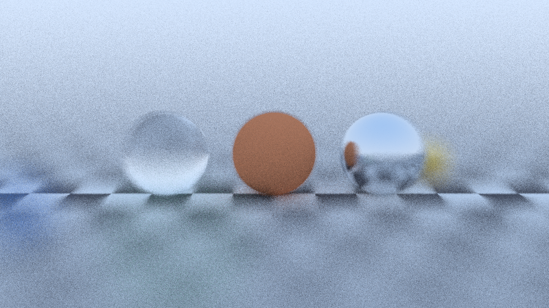
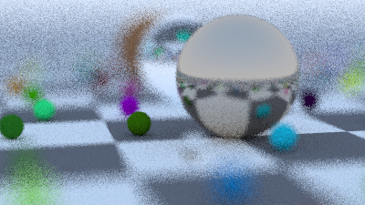

<div align="center">

# raydiant

**A small ray tracer written from scratch in pure Python. No libraries, no GPU, just vectors and patience.**


[](LICENSE)



</div>

raydiant shoots rays through every pixel of the image, bounces them around a
scene of spheres, and adds up the light each ray picks up. Camera, rays,
hittables, materials, and a sky gradient for the rays that miss everything.
The whole thing runs on the standard library, including a hand written PNG
encoder (zlib and struct, nothing else).

## The renders

The hero above is the `trio` scene: a checker floor, a glass sphere, a matte
red one, and a metal one, with defocus blur softening the background. It
rendered at 800x450 with 32 samples per pixel and a bounce depth of 20 in
383 seconds on a 2 vCPU cloud VM, measured 2026-10-19.



The second built-in scene is `cover`: about a hundred small random spheres on a
checker plane with three large ones, generated from a fixed seed so it comes
out the same every time. That one rendered at 400x225 with 12 samples per
pixel and a bounce depth of 10 in 307 seconds on the same machine.
It is smaller because pure Python pays for every sphere a ray is tested
against, and there are over a hundred of them.

## How it works

Each pixel gets a handful of samples, jittered inside the pixel square and
averaged, which is what smooths the edges and the noise. A ray that hits
something asks the surface material what to do: matte surfaces scatter in a
random direction, metal reflects with a configurable roughness, and glass
either reflects or refracts based on the Schlick approximation, which is why
the glass sphere shows the checkerboard behind it. Rays that hit nothing get
the sky gradient. Colors are gamma corrected before writing.

Two details I care about: the random numbers are seeded per row, so a given
seed produces the identical image no matter how many worker processes you
use. And rows are independent, so they render through a process pool, each
worker taking a chunk of rows.

## Run it

There is no install step. Clone it and go:

```
git clone https://github.com/SachuJames/raydiant.git
cd raydiant
python3 -m raydiant render --scene trio --width 800 --spp 32 --depth 20 --seed 7 --jobs 2 --out renders/trio.png
```

The `cover` scene:

```
python3 -m raydiant render --scene cover --width 400 --spp 12 --depth 10 --seed 42 --jobs 2 --out renders/cover.png
```

Change `--out` to a `.ppm` name if you want the plain text format instead of
PNG. Smoke test first if you are impatient: `--width 160 --spp 4 --depth 8`
finishes in a couple of seconds.

## Knobs

- `--scene`: `trio` or `cover`
- `--width`: image width in pixels, height is 16:9 from it
- `--spp`: samples per pixel, more is less noisy
- `--depth`: how many times a ray may bounce
- `--seed`: change it for a different noise pattern, or a different `cover`
- `--jobs`: worker processes, rows are split between them
- `--out`: where to write the image, PNG or PPM by extension

## Layout

```
raydiant/
  vec3.py       vectors, dot/cross, reflect, refract, random helpers
  ray.py        rays
  hittable.py   spheres, an infinite plane, lists of hittables
  material.py   lambertian, metal, dielectric, checker texture
  camera.py     positionable camera with defocus blur
  image.py      hand written PNG encoder and a PPM writer
  scenes.py     the trio and cover scenes
  render.py     the path tracing loop, parallel rows
  cli.py        the command line interface
tests/          21 tests: math, intersections, materials, image bytes,
                and a tiny end to end render
```

## License

MIT. See [LICENSE](LICENSE).
